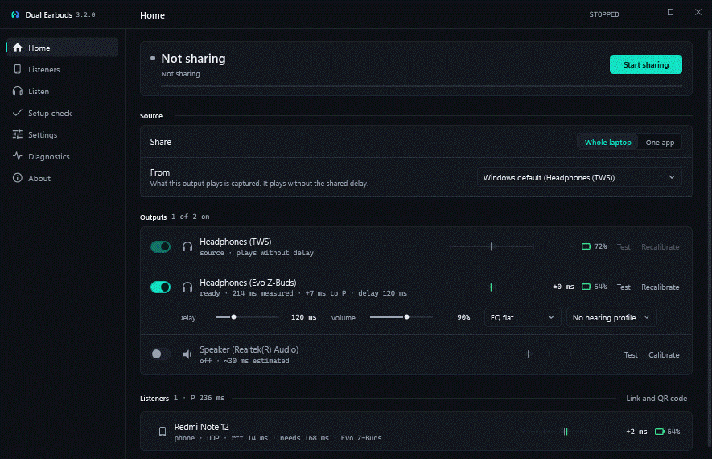
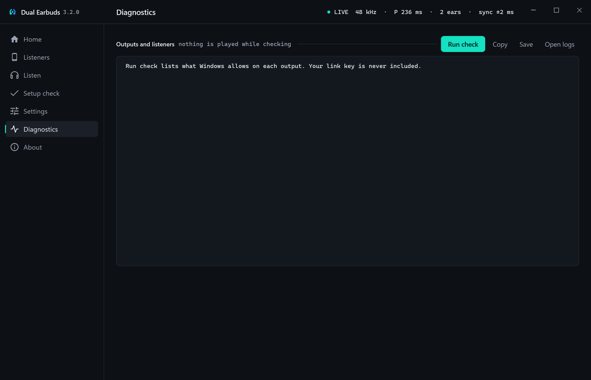
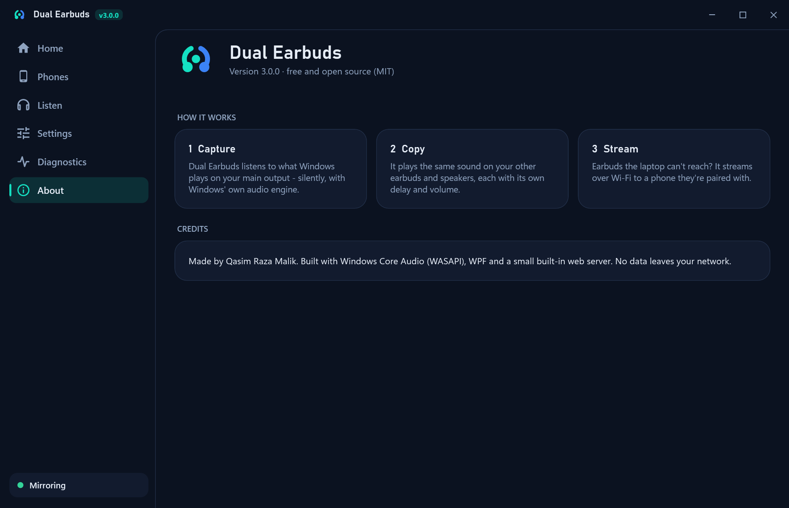
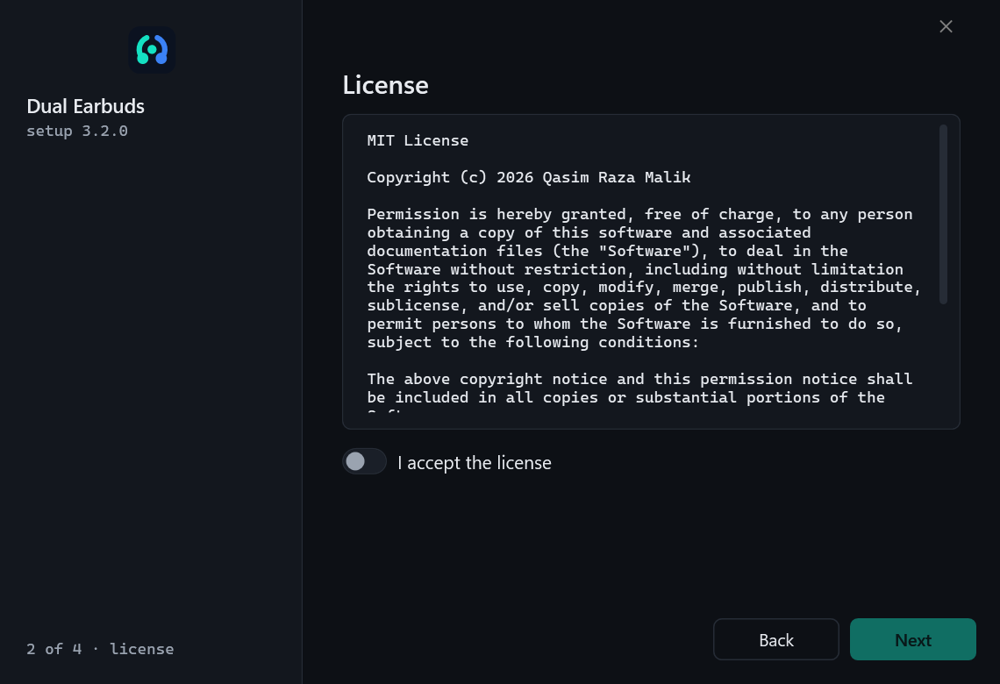
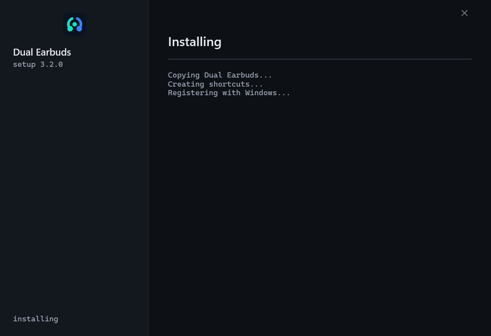
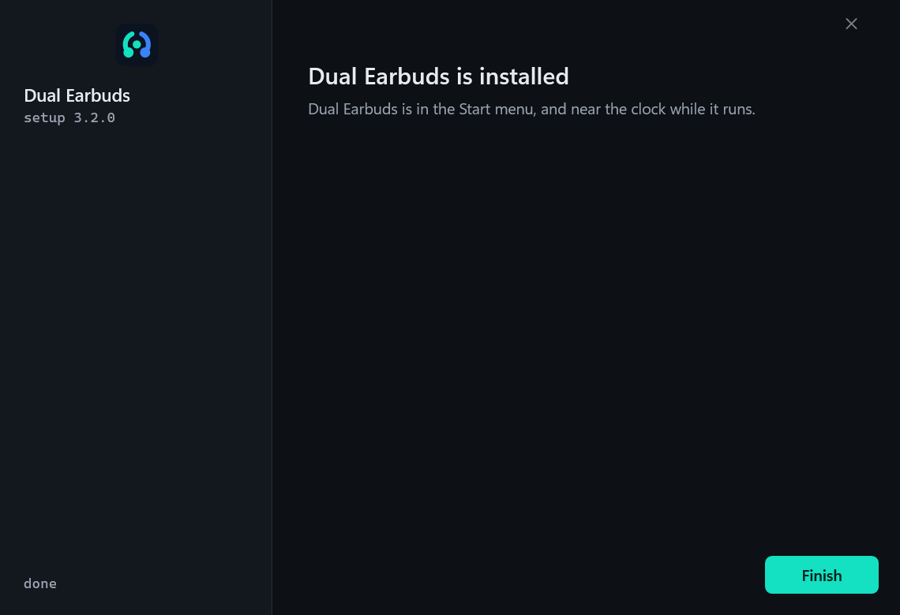
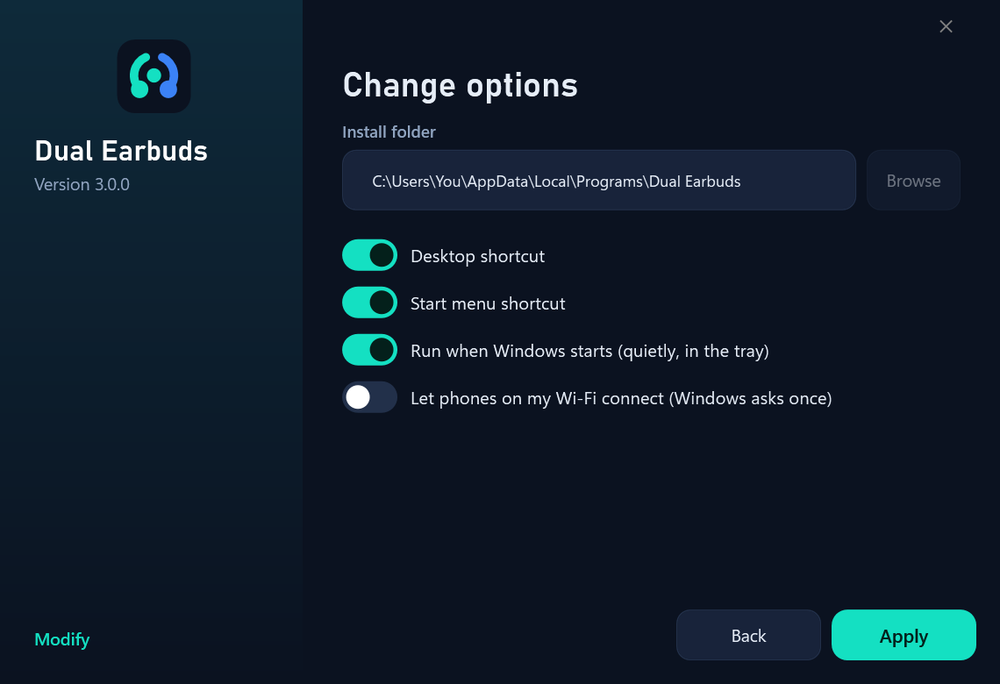
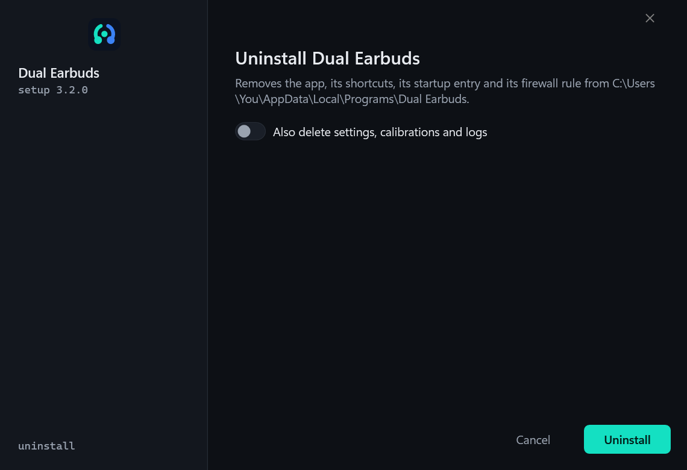
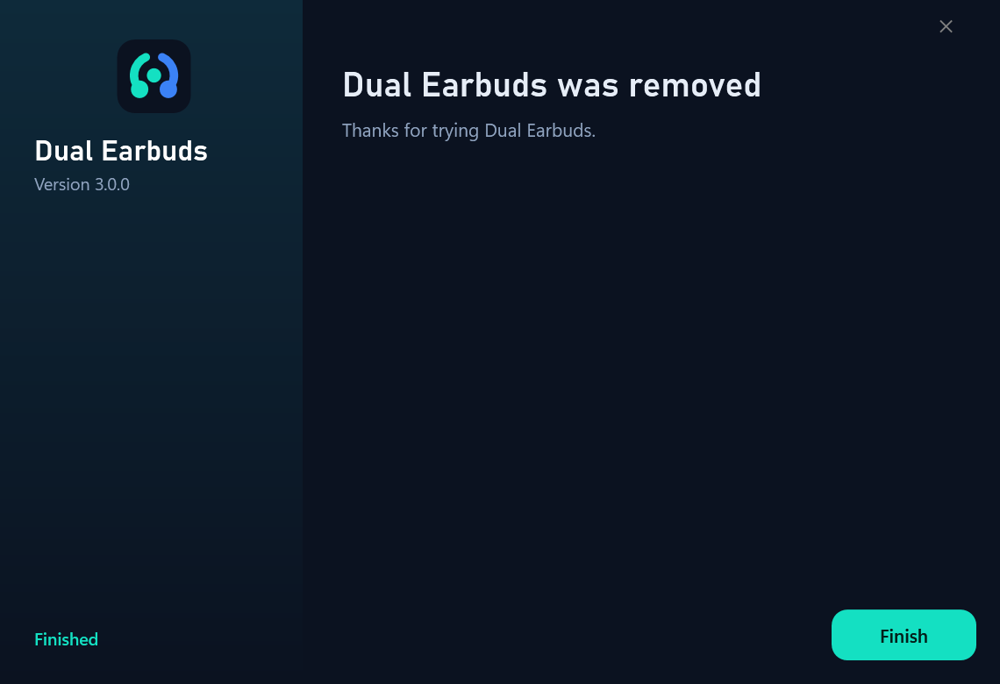
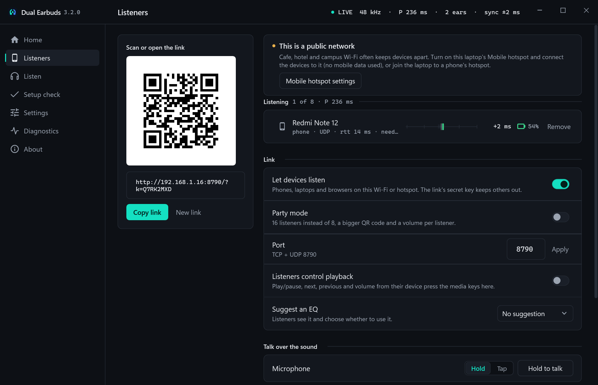

# Dual Earbuds Pro

Play your laptop's sound on **two (or more) pairs of earbuds at the same time**, and stream it over Wi-Fi to phones so even more people can listen, each on their own earbuds.




---

## What it does

| | |
|---|---|
| **Mirror to many outputs** | Captures what Windows is playing (WASAPI loopback) and plays it on every output you tick: Bluetooth earbuds, headphones, speakers. |
| **Per-output delay and volume** | Delay 0–1000 ms (to line up earbuds that lag) and volume 0–150 % for each output. |
| **Battery levels** | Shows the battery % Windows reports for each pair of Bluetooth earbuds. |
| **Phone link** | Streams the sound over your Wi-Fi to phones. Scan the QR code, tap Start, listen on the earbuds paired to the phone. Up to 8 phones. Each link has a secret key; only phones with the link can connect. |
| **Works in the background** | Lives near the clock. Closing the window keeps it running (you can change that). Ctrl + Alt + M starts or stops mirroring from anywhere. |
| **Recovers by itself** | If the sound source disappears or an output drops, it keeps retrying and picks things up again. New earbuds appear in the list as soon as Windows sees them. |
| **Diagnostics** | One click builds a report (devices, formats, errors, logs) you can copy when something doesn't work. |
| **Dark and light themes** | Follows Windows, or pick one. |
| **Proper installer** | Install, repair, modify and uninstall windows. No administrator rights needed. |

Nothing leaves your network: no accounts, no cloud, no tracking.

## Screenshots

| Home | Phones |
|---|---|
|  |  |
| **Settings** | **Diagnostics** |
|  |  |
| **Light theme** | **About** |
|  |  |

### Installer

| Welcome | License | Options |
|---|---|---|
|  |  |  |
| **Installing** | **Finished** | **Repair / Modify / Uninstall** |
|  |  |  |
| **Modify** | **Uninstall** | **Removed** |
|  |  |  |

---

## Install

1. Run **`DualEarbuds-Setup.exe`**.
2. **Next** → accept the license → choose options → **Install**.
   - *Let phones on my Wi-Fi connect* adds a firewall rule so phones can reach the laptop, at home and on public Wi-Fi; Windows asks for permission once. Only phones with the link's secret key can connect, and a device that tries many wrong keys is ignored for 5 minutes.
3. Dual Earbuds opens. It also appears in the Start menu and near the clock.

Installs to `%LOCALAPPDATA%\Programs\Dual Earbuds` for your Windows account only. Settings and logs live in `%LOCALAPPDATA%\DualEarbuds`.

### Repair, change or uninstall

- **Settings → Apps → Installed apps → Dual Earbuds → Modify / Uninstall**, or
- run `DualEarbuds-Setup.exe` again: it shows **Repair**, **Modify** and **Uninstall**.

Uninstall can keep or delete your settings and logs.

### Silent install (for scripts)

```
DualEarbuds-Setup.exe --silent [--dir "C:\path"] [--no-desktop] [--no-startmenu] [--startup] [--no-firewall]
DualEarbuds-Setup.exe --silent --repair
DualEarbuds-Setup.exe --silent --uninstall [--remove-data]
```

---

## Step by step

### Two pairs of earbuds on the laptop

1. Connect both pairs in **Windows Settings → Bluetooth & devices**.
2. Play something on the laptop (it plays on the Windows default output, the *sound source*).
3. In Dual Earbuds, on **Home**, turn on the switch next to the second pair.
4. Press **Start mirroring** (or Ctrl + Alt + M).
5. If one pair is behind the other, raise **Delay** on the pair that is *ahead* until they line up.

> **If the second pair says it can't be opened:** many laptop Bluetooth chips can only send stereo music to **one** Bluetooth device at a time. Windows refuses the second one (error `0x8889000F`). No software can get around that limit; use the **phone link** below for the second pair instead. A cheap USB Bluetooth adapter for the second pair also works, because it has its own radio.

### A phone (and its earbuds) as the second listener

1. Pair the second earbuds with the phone. Put the phone on the **same Wi-Fi** as the laptop.
2. Open the **Phones** page in Dual Earbuds.
3. Scan the QR code with the phone (Dual Earbuds Android app, or the camera to open it in Chrome).
4. Tap **Start** on the phone.
5. The phone's earbuds usually play a little behind the laptop's. Raise **Delay** on the laptop's earbuds (Home page) until they match. The phone shows its own delay too.

With the **Android app**, playback keeps going with the screen off and in the background (including on Xiaomi, Redmi and Realme phones, after allowing the battery exemption the app asks for). The browser player works too, but phones may pause it when the screen turns off.

### Outside home (café, hotel, university Wi-Fi)

The phone link works on public Wi-Fi too. When you're on one, the **Phones** page says so.

 If the phone still can't open the link, that Wi-Fi is blocking devices from talking to each other. Use a hotspot instead:

1. Turn on the **hotspot on the phone** and connect the laptop to it, **or** turn on **Mobile hotspot** on the laptop (Settings → Network & internet → Mobile hotspot) and connect the phone to it.
2. Scan the QR code again (the laptop's address changes on a new network).

The sound goes straight between the laptop and the phone, so it **doesn't use mobile data**.

---

## Troubleshooting

| Problem | What to do |
|---|---|
| Second earbuds show *"Windows can only play to one Bluetooth stereo device"* | Hardware limit of the laptop's Bluetooth chip. Use the phone link, or a USB Bluetooth adapter for the second pair. |
| Phone can't open the link | Same Wi-Fi? Some networks, especially public ones (cafés, hotels, universities), block devices from reaching each other ("client isolation") - use a hotspot instead (see *Outside home* below). Allow the firewall rule (Setup → Modify). |
| *"Link expired"* on the phone | You pressed **New link** on the laptop. Scan the new QR code. |
| Phone sound stutters | Move closer to the router, or raise the phone's buffer. 5 GHz Wi-Fi works best. |
| Earbuds out of sync | Raise **Delay** on whichever plays first. |
| Battery % doesn't show | Windows only reports battery for some earbuds. |
| Anything else | **Diagnostics → Copy report**, and look at the logs folder. |

---

## Build from source

Only needs what ships with Windows (.NET Framework 4.8 C# compiler). No Visual Studio, no downloads.

```powershell
powershell -ExecutionPolicy Bypass -File build.ps1          # dist\DualEarbuds.exe + dist\DualEarbuds-Setup.exe
powershell -ExecutionPolicy Bypass -File build.ps1 -Docs    # also renders docs\images (screenshots, demo GIF, installer screens)
```

The screenshots are rendered offscreen from demo data: no window opens and no sound plays.

### Project layout

```
src/Engine/   audio engine (WASAPI capture + render), phone link server, web player, battery, QR code, settings, logs
src/App/      WPF window, pages, tray, theme, icon, screenshot tool
src/Setup/    installer: install / repair / modify / uninstall (UI + silent)
tests/        engine tests (ring buffer, conversions, delay, settings, QR, HTTP + WebSocket server)
PROTOCOL.md   the phone link protocol shared by the browser player and the Android app
```

### Developer switches

```
DualEarbuds.exe --tray              start hidden near the clock
DualEarbuds.exe --uitest out.txt    build every page offscreen with demo data and report layout problems
DualEarbuds.exe --screenshots dir   render screenshots + demo.gif
DualEarbuds.exe --battery out.txt   dump the battery levels Windows reports
DualEarbuds-Setup.exe --test-root dir   run the installer inside a sandbox folder + private registry key (QA)
```

Set `DUALEARBUDS_DATA` to use a different settings/logs folder.

---

## License

MIT © 2026 Qasim Raza Malik
