<div align="center">


# Dual Earbuds

**Play one sound on two or more pairs of earbuds at once — from your Windows laptop or your Android phone.**

Watch a movie together, share music on a trip, run a silent party. Free, open source, no account, no cloud.

[Download for Windows](https://github.com/qasimrazamalik-coder/dual-earbuds/releases/latest/download/DualEarbuds-Setup.exe) ·
[Download for Android](https://github.com/qasimrazamalik-coder/dual-earbuds/releases/latest/download/DualEarbuds.apk) ·
[How it works](#how-it-works) · [FAQ](#faq)

</div>

---

## What it does

Windows and most phones send stereo audio to one pair of Bluetooth earbuds at a time. Dual Earbuds
captures what a laptop or Android phone is playing and plays it on several outputs at once: the laptop's
own outputs, and other phones and laptops over Wi-Fi or a hotspot, each with its own earbuds.

| | |
|---|---|
| **Pairs** | Laptop outputs plus up to 8 listeners, 16 in Party mode |
| **Hosts** | Windows laptop (any sound, including Netflix in the browser), Android 10+ phone |
| **Listeners** | Android app, Windows app (laptop to laptop, phone to laptop), any browser via link, including iPhone |
| **Sync** | One deadline for every ear: the host picks the playout delay from what each listener needs, delays its own outputs to match, and every device calibrates its earbuds' latency |
| **Transport** | 10 ms PCM packets; UDP with redundancy for native listeners, WebSocket fallback and for browsers |
| **Joining** | Automatic discovery on the same network, QR code, or a pasted link; optional room PIN |
| **Source** | Whole device or a single app (Windows 10 build 20348+/11, Android capture rules apply) |
| **On-device processing** | Optional smart EQ, dialogue boost, night mode, adaptive buffer, hearing profiles, mic noise suppression for talk-over |
| **Privacy** | Local network only, per-link secret key, guessing lockout, no account, no cloud |
| **Footprint** | Windows app under 1 MB on .NET Framework 4.8 (built into Windows); signed APK with in-app updates |

## Screenshots

| Home | Phones & Party mode |
|---|---|
| 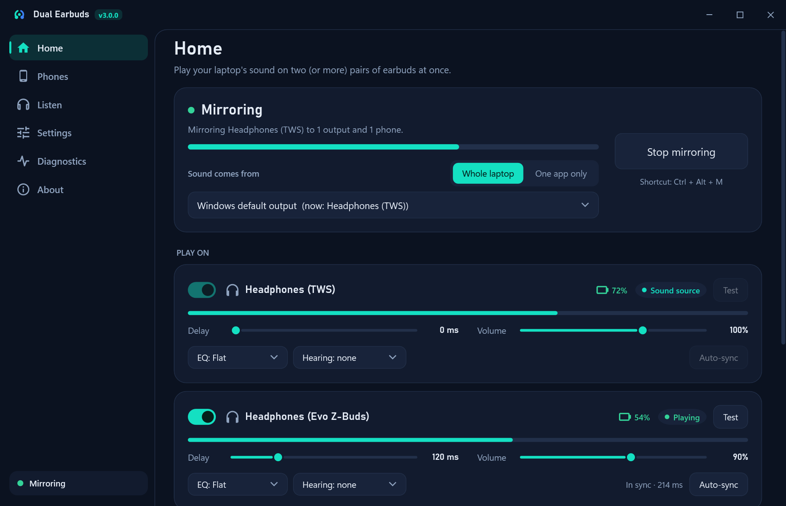 | 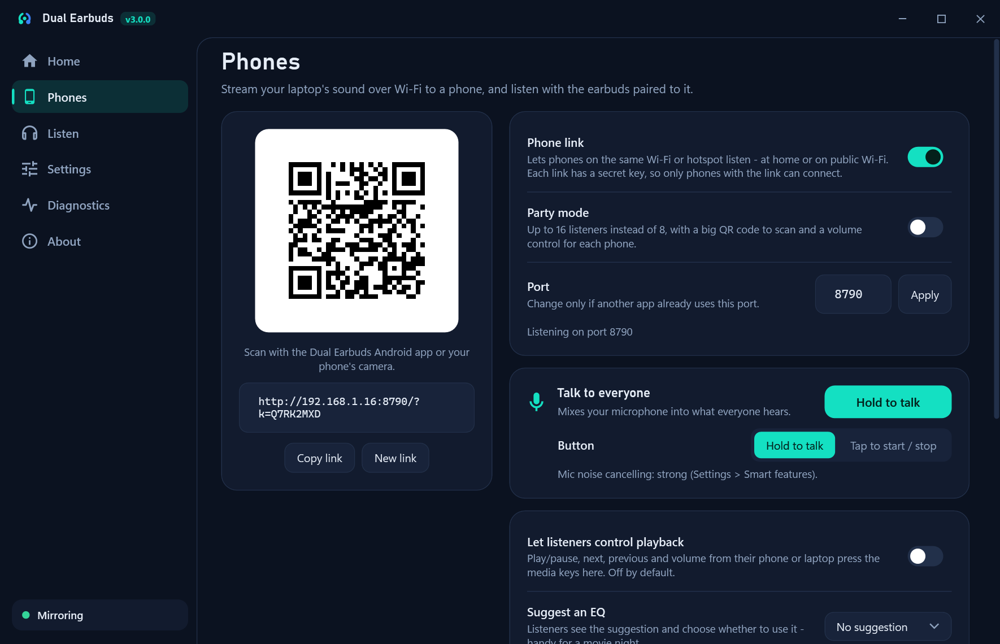 |
| **Settings** | **Light theme** |
| 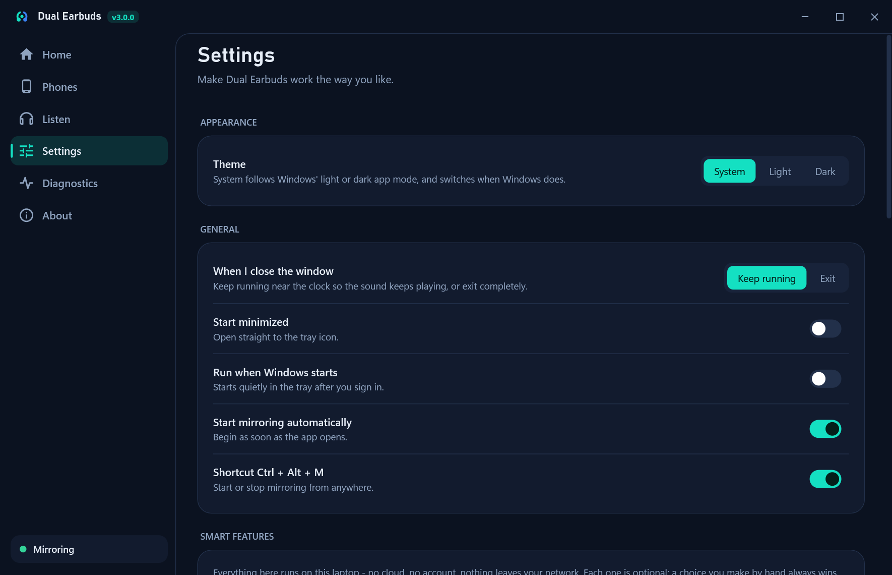 | 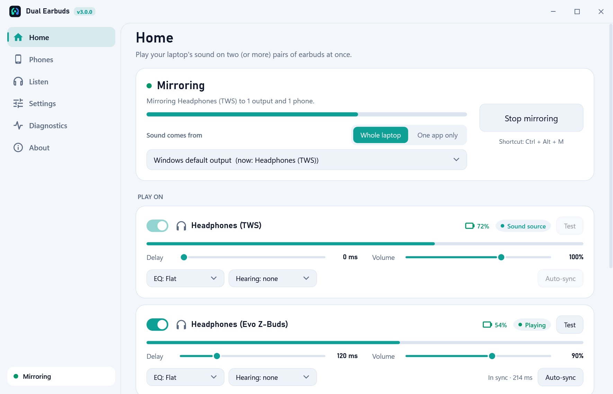 |
| **Party mode with room PIN** | **Smart features** |
| 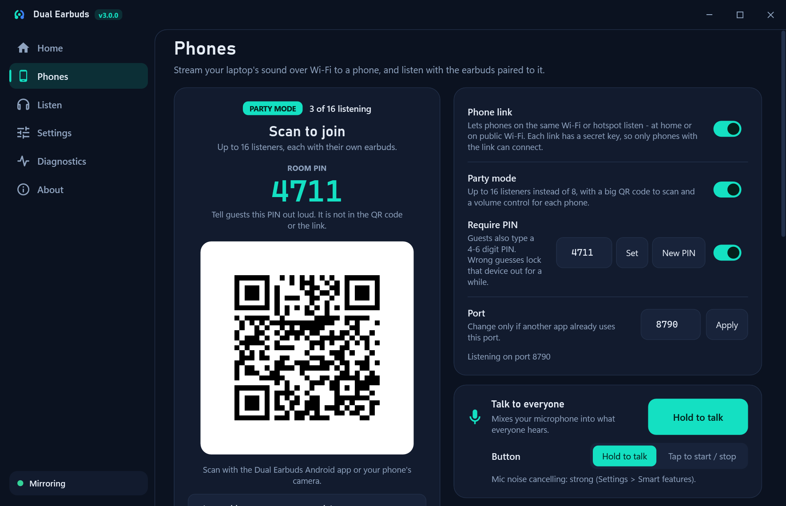 | 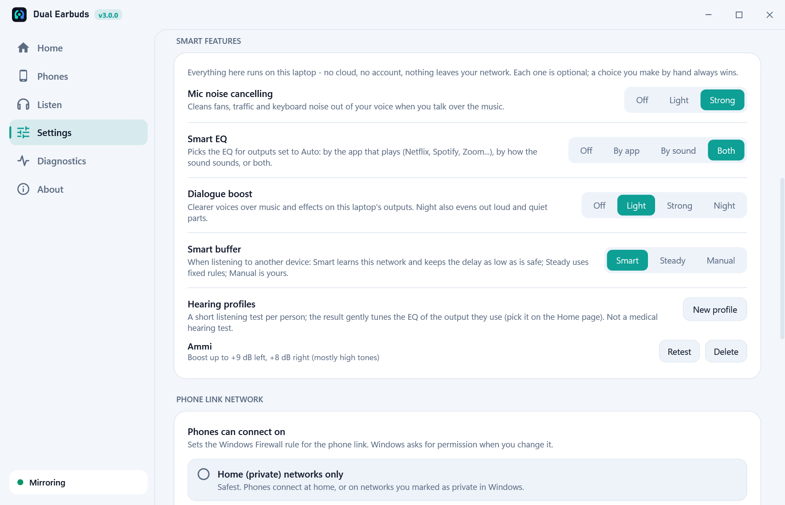 |
| **Laptop to laptop** | **Appearance** |
| 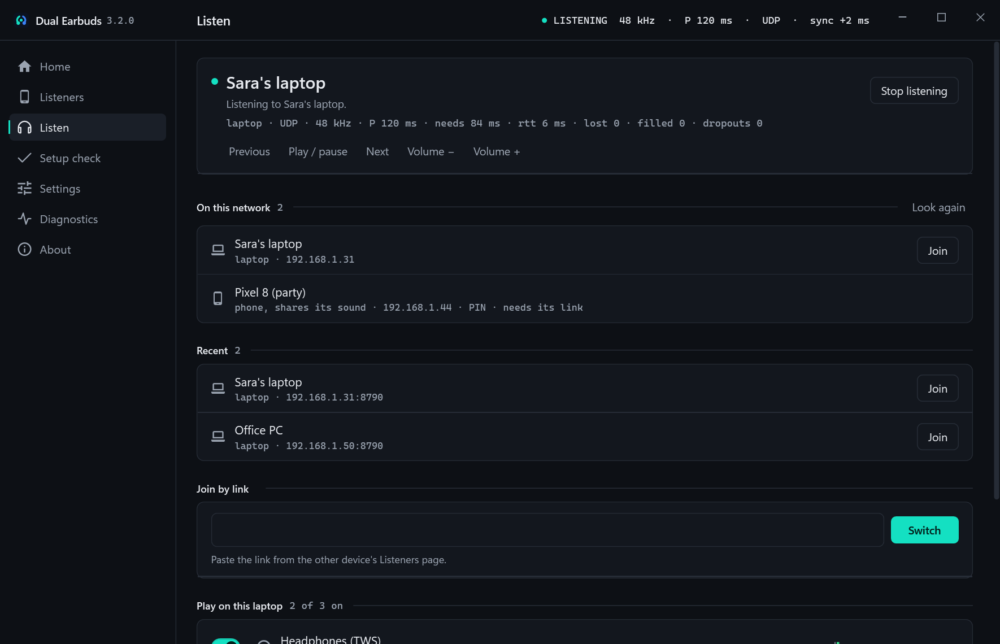 | 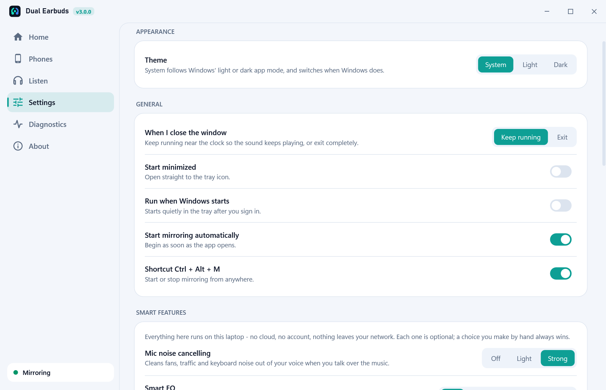 |

<details>
<summary>Installer screens</summary>

| | | |
|---|---|---|
| 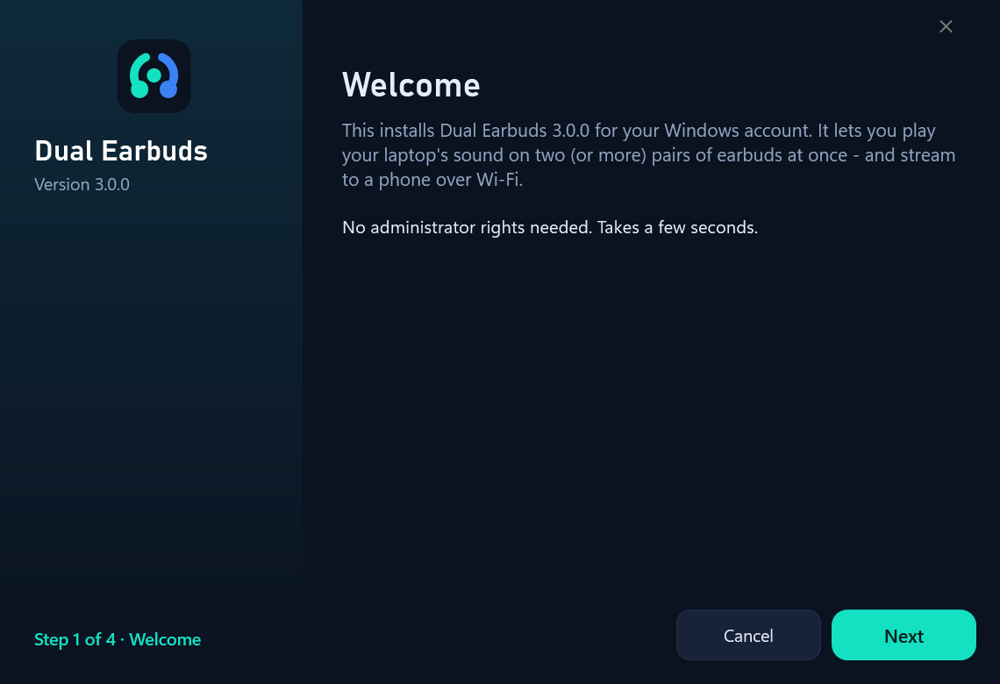 | 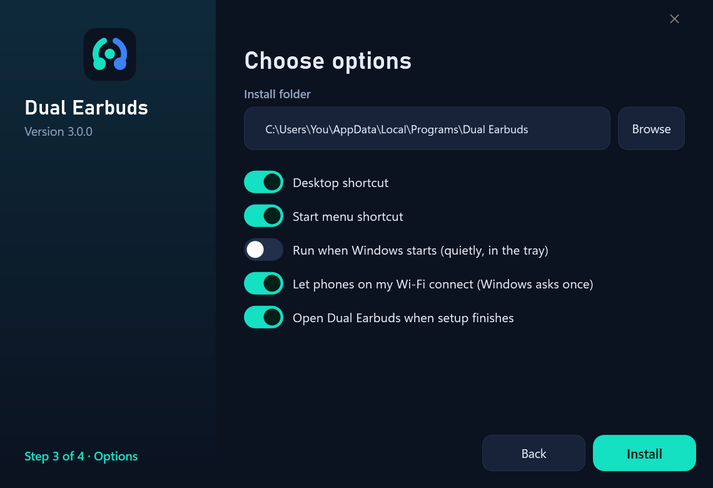 | 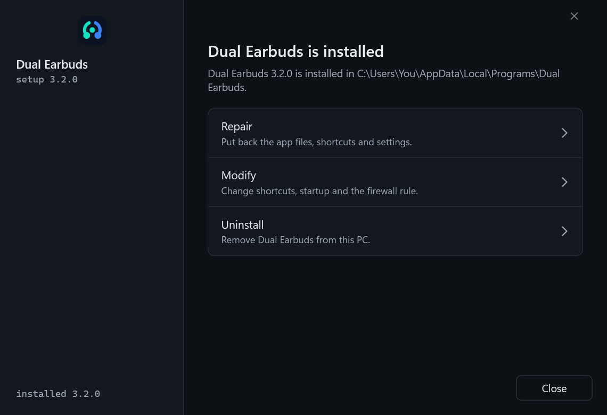 |

</details>

## How it works

```
             ┌───────────────── Wi-Fi / hotspot ─────────────────┐
 Laptop ──► Dual Earbuds (Windows) ──► phone 1 ──► earbuds pair 2
   │                                 └─► phone 2 ──► earbuds pair 3
   └──► earbuds pair 1 (Bluetooth)        …up to 16 phones
```

1. The host (Windows laptop or Android phone) captures what it is playing and stamps every 10 ms packet with its clock.
2. Listeners sync their clocks to the host and report how much delay they need for their Wi-Fi and earbuds.
3. The host picks one deadline that covers everyone, delays its own outputs to it, and every ear plays each packet at
   that moment ([protocol](docs/protocol.md)).

### For the best sound and sync

- Use a 5 GHz Wi-Fi network or a phone/laptop hotspot; keep listeners in the same room.
- Calibrate each pair of earbuds once (hold an earbud to the mic, tap **Calibrate**).
- On phones, prefer AAC or SBC over LDAC (Developer options → Bluetooth audio codec); LDAC adds delay.
- Let the app run unrestricted in the background (the app's **Setup check** shows what to change on Samsung, Xiaomi/Redmi, Realme/OPPO).

## Get started

### Windows
1. Download **[DualEarbuds-Setup.exe](https://github.com/qasimrazamalik-coder/dual-earbuds/releases/latest/download/DualEarbuds-Setup.exe)** and run it (no admin rights needed).
2. Connect your earbuds in Windows Bluetooth settings, play something, tick the outputs, press **Start** (or **Ctrl + Alt + M**).

### Android
1. Download **[DualEarbuds.apk](https://github.com/qasimrazamalik-coder/dual-earbuds/releases/latest/download/DualEarbuds.apk)** on the phone and install it (allow "install unknown apps" once).
2. Pair your earbuds with the phone, scan the QR code on the laptop's **Phones** page, tap **Start**.

### Party mode
Turn on **Party mode** on the host (laptop or phone): up to 16 listeners, each with their own volume. Guests can join from the app or straight from the browser.

### Outside home (café, hotel, university Wi-Fi)
It works on public Wi-Fi too. If a phone can't reach the laptop, that network blocks devices from seeing each other — use a **hotspot** (phone hotspot, or Windows **Mobile hotspot**). The sound goes directly between the devices and **doesn't use mobile data**.

## FAQ

**Can Windows play to two Bluetooth earbuds at once by itself?**
Most laptop Bluetooth chips send stereo music to only one device at a time (Windows error `0x8889000F` for the second). Dual Earbuds uses a phone, or a second USB Bluetooth adapter, for every extra pair.

**Does it work with Netflix?**
Yes, when Netflix plays on the laptop. Netflix on an Android phone blocks other apps from capturing its sound, so phone-to-phone sharing can't include it — on Samsung phones use built-in **Dual Audio** (Quick panel → Media output → tick both earbuds) instead.

**Is there an iPhone app?**
Not yet. iPhones can listen through the browser player today (it pauses when the screen turns off).

**Does it need the internet?**
No. Only the optional update check uses the internet.

## Build from source

| Part | Stack | Build |
|---|---|---|
| Windows app + installer | C# 5, WPF, WASAPI, .NET Framework 4.8 (built into Windows) | `powershell -File windows\build.ps1` |
| Android app | Kotlin, Jetpack Compose, AudioTrack, AudioPlaybackCapture | `gradle -p android assembleRelease` |
| Shared | [Link protocol v3](docs/protocol.md), [smart features](docs/smart-features.md), [browser player](shared/web-player.html) | — |

CI builds, tests and publishes both apps on every tagged release.

```
dual-earbuds/
├── windows/   Windows app (src/Engine, src/App, src/Setup), tests, build script
├── android/   Android app (app/) and phone-to-phone host module (host/)
├── shared/    browser player page served by every host
├── docs/      protocol, screenshots
└── assets/    logo
```

## License

[MIT](LICENSE) © 2026 [Qasim Raza Malik](https://github.com/qasimrazamalik-coder) · Contact: iamqasimrazamalik@gmail.com

<sub>Keywords: play audio on two bluetooth headphones windows, connect two earbuds to one laptop, share audio to multiple phones, dual audio android, silent disco app, listen together over wifi.</sub>
